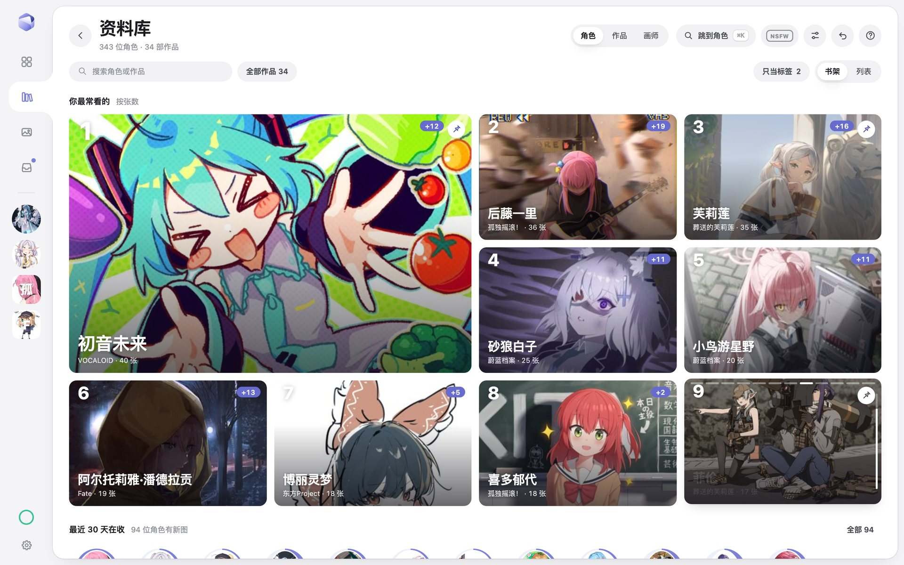
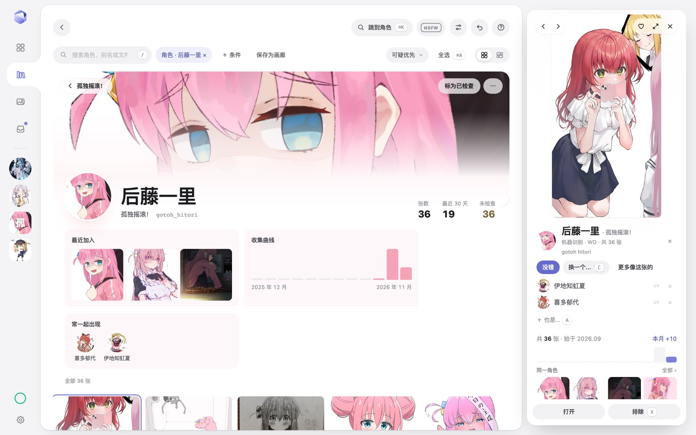
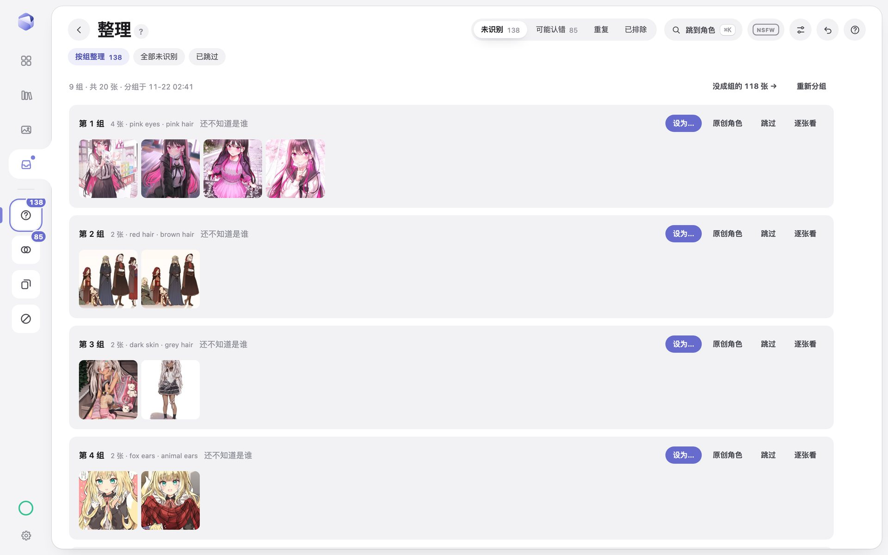
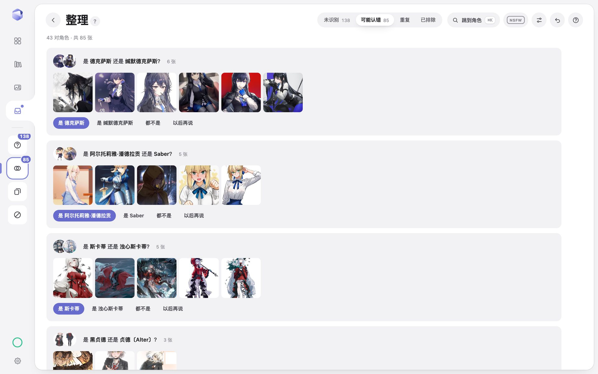
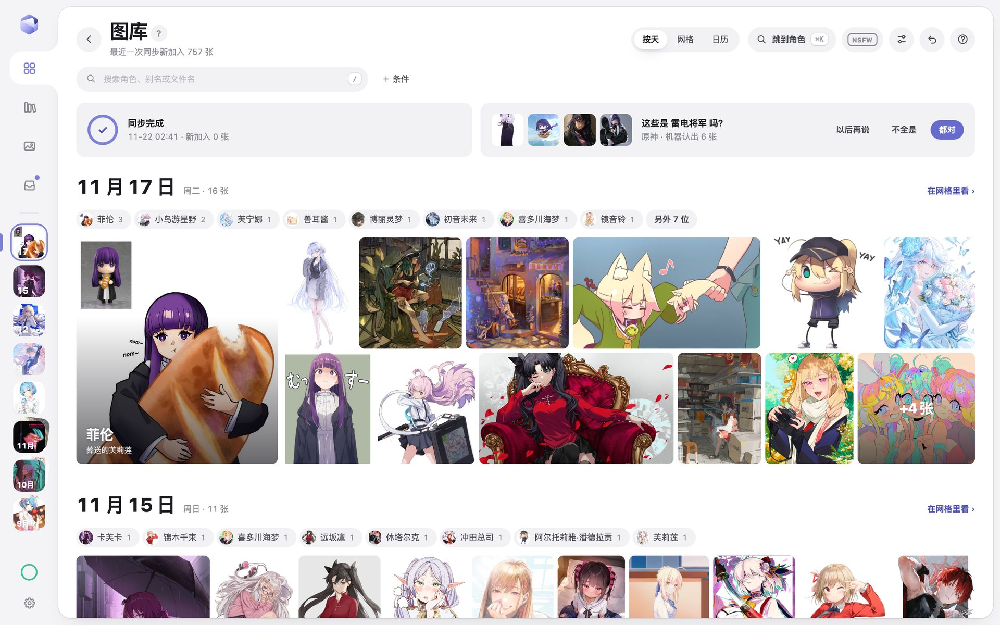
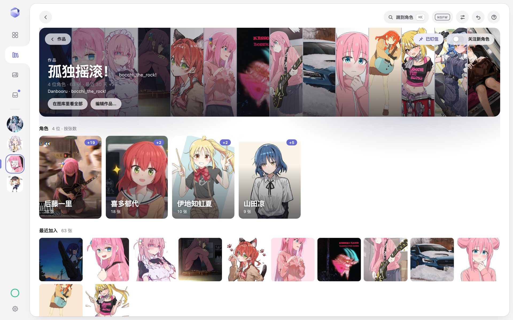
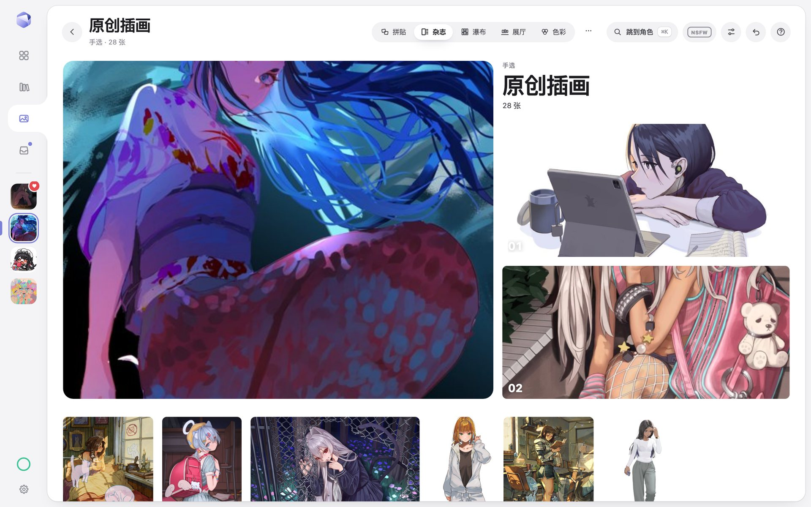
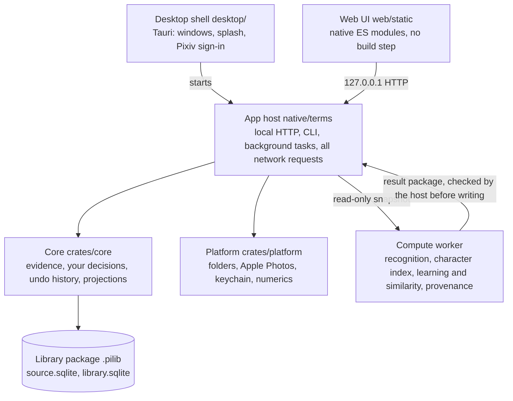

<div align="center">


# Illustash

**A lightweight smart album for anime illustrations.**

Covers 15,000+ characters, with automatic local recognition and management of characters, artists, and tags

[](https://github.com/shio-vinyl/illustash/releases/latest)
[](LICENSE)
[%20%C2%B7%20Windows%20x64-lightgrey.svg)](#download)
[](#how-it-works)

[**Download**](https://github.com/shio-vinyl/illustash/releases/latest) · [Recognition and organization](#recognition-and-organization) · [Pixiv and X integration](#pixiv-and-x-integration) · [Browsing and management](#browsing-and-management) · [Privacy](#privacy) · [How it works](#how-it-works)

English · [简体中文](README.zh-CN.md)

</div>



<sub>Screenshots show the Chinese interface and come from a demo library picked for this purpose. The illustrations belong to their original artists; to request removal, please <a href="https://github.com/shio-vinyl/illustash/issues">open an issue</a>.</sub>

Illustash reads illustrations saved from X and Pixiv in macOS Photos and local folders, recognizes characters and picture content on your computer, and builds a catalog by series, character, and form. Results can be corrected by hand, and later recognition takes the corrections into account. Through its Pixiv and X integration, Illustash finds artists and original posts without uploading pictures. Unlike asset managers such as Eagle, it does not require setting up categories or tagging pictures by hand.

## Recognition and organization

Recognition and sorting are done by the machine. You only confirm or correct results while browsing, and the corrections are used in later recognition.

**Character catalog**: Characters in each picture are recognized and arranged into a catalog of series → character → form. Series can be nested, and forms cover outfits, alternate versions, transformations, and so on. A group picture appears in the catalog of every character in it. Characters can be searched by Chinese, Japanese, or English name, alias, or original tag; series, characters, and original characters not yet in the catalog can be created by hand.

**Coverage**: About 15,000 characters are covered. With the models downloaded, about 7,400 characters are recognized, and the character pack covers about 8,000 more lesser-known and newly introduced characters. The character pack is updated periodically; an update only rescores existing recognition results, with no need to recognize pictures again. Characters still missing from followed series can be added with reference pictures from Danbooru.

**Requirements**: The installer is under 40 MB and works right after installation, with no need for Python, Docker, CUDA, or a dedicated graphics card. On Apple silicon Macs, recognition is accelerated with Core ML and handles about 10,000 pictures per hour on an M2. On Windows it uses DirectML when a graphics card is available and also runs on the CPU alone. Results are written to the library in batches, so browsing can start while recognition is still running. For how the models were chosen, see [Model choices and trade-offs](#model-choices-and-trade-offs).

**Corrections and learning**:

- When a character is wrong, it can be changed, removed, or merged. Marks such as confirm and reject take one click, with no dialogs and no required fields. Every action can be undone, including after a restart.
- Confirmations and rejections you make always take precedence; re-running recognition or updating the character pack never overwrites them.
- Once 5 pictures of a character are confirmed, Illustash learns that character's features on your computer and uses them to recognize other outfits and art styles of the same character.
- Low-confidence results are listed under “Might also be” and stay out of the catalog. The home page occasionally shows a “Who's this?” card to collect confirmed examples for characters with low confidence or few examples.
- Unidentified characters and original characters are grouped automatically by look, hair color, eye color, animal ears, and similar traits; once the character is known, the whole group can be assigned at once.
- Pending-work counts are hidden by default, and the library can be used before everything is sorted.







**Picture content**: About 8,100 picture tags are recognized, about 7,700 of them with Chinese names; R18 ratings are detected; photos, screenshots, chat logs, text-only images, and other non-illustrations are excluded automatically. Custom tags can be added as well.

**Duplicates and variants**: Pictures are compared pixel by pixel on your computer to find re-saves, crops, versions with added or removed text, censored versions, and variants, which are then grouped together. Duplicates fold by default, and changing the character of any picture in a group updates the whole group. “Compare” marks the areas where two pictures differ.

**Planned**: flagging illustrations that appear to be AI-generated ([#184](https://github.com/shio-vinyl/illustash/issues/184)).

## Pixiv and X integration

Illustash links the library with Pixiv and X. It currently finds artists and original posts, and will later bring in platform tags and recommendations to build a personal taste system.

**Finding artists and original posts**: Pictures can be looked up in batches, and no picture is ever uploaded.

- Danbooru pixel hash: the picture is decoded and its pixel hash is computed to find the same picture; only the hash is sent. Changes that saving apps make to the file do not affect it.
- IQDB image signature: computed on your computer to find resized or recompressed versions; only the signature is sent.
- Following lists: accounts you follow on Pixiv (signed in within the app, read-only) and in your X data archive become candidate artists. Thumbnails of their public works are downloaded and compared on your computer, and an artist is confirmed only when they match. The thumbnails are deleted after comparison; only the signatures used for matching are kept.

Once an artist is found, “Find more of their pictures” looks for that artist's other works in the library; pictures in the same duplicate or similar group share the artist found; pictures saved in one continuous stretch are listed as candidates to confirm. The “Artists” tab in the Catalog can be sorted by picture count, recent additions, or name, shows all pictures by one artist, and opens the artist's profile and the original posts. “It's them” and “Not them” can be undone like any other action.

**Personal taste system (planned)**: Illustash records which pictures were actually saved, excluded, and rejected, which is information the platforms cannot see. The plan is to combine it with Pixiv and X ([#609](https://github.com/shio-vinyl/illustash/issues/609), [#553](https://github.com/shio-vinyl/illustash/issues/553)):

- add Pixiv tags to pictures matched to their original posts, and use those pictures as examples to infer the same tags for other pictures, supplementing recognition;
- train a personal preference model from favorites to sort the library;
- re-rank and filter new works from followed artists, Pixiv recommendations, and tag search results by personal taste, with a reason for each recommendation;
- suggest candidate artists for Pixiv pictures without a known source, using an art-style model ([#455](https://github.com/shio-vinyl/illustash/issues/455)).

All of these run only when you trigger them, with request volumes similar to normal browsing, and without uploading pictures.

## Browsing and management

**Browse**: The Catalog has series, character, and artist directories. Pictures can be added to favorites, and “More like this” finds similar pictures by picture or by character, starting from one or more pictures.





**Filter**: The filter bar combines characters, series, artists, picture tags, custom tags, origin, year, date range, and favorites, and each condition can be set to include or exclude. Picture tags can be searched in Chinese, Japanese, or English. Frequently used filters can be saved as galleries, which appear in the sidebar. R18 content can be hidden or shown on its own.



**Use**: Pictures can be opened, shown in Finder or File Explorer, dragged into other apps, or exported as copies into folders by character or artist. Exports never overwrite existing files and never modify the originals.

**Sources and data**:

- macOS Photos is connected read-only, includes only pictures saved from X and Pixiv, and is organized by origin; local folders are assigned an origin when added. When a folder moves, its pictures and their organization can be matched back by relative path and file content.
- Multiple libraries are supported. Human decisions are snapshotted automatically and can be exported as a standalone file; the library is backed up automatically before a format upgrade.
- Closing the window while a task is running keeps the task going in the background, with a system notification when it finishes. Updates can be checked for in the app and are installed after their signature is verified.

**Planned**: a local network entry point on the desktop, so a phone can scan a code and browse the library ([#459](https://github.com/shio-vinyl/illustash/issues/459)).

## Privacy

- Recognition, learning, and comparison all run on your computer. Pictures and features computed from them are never uploaded, never sent to an LLM, and never used to train shared models.
- Original files are never modified, and Photos is accessed read-only.
- Network features are off by default and authorized per feature. Settings lists what each network feature sends.
- Pixiv, X, and Danbooru are optional. Your own accounts are used, with read-only, low-frequency access that stops on a CAPTCHA or rate limit. Illustash was not created or distributed by pixiv and is not affiliated with any of these sites.

## Download

Illustash is free and open source. Download the latest version from [GitHub Releases](https://github.com/shio-vinyl/illustash/releases/latest).

| Platform | Installer |
|---|---|
| macOS 14 or later, Apple silicon | `…_aarch64.zip` |
| Windows x64 | `…_x64-setup.exe`, installs for the current user without administrator rights |

The installers are not notarized by Apple or code-signed for Windows, so the system blocks them the first time they are opened; allow them once as described in [Troubleshooting installation and launch](docs/INSTALL.md) (in Chinese). After that, updates can be checked for in the app and installed with “Download and restart”.

Recognition models are downloaded in the app on first use, about 640 MB, plus an acceleration file of about 470 MB on Apple silicon Macs. They can also be imported offline; see [Recognition models](docs/INSTALL.md#识别模型) (in Chinese). The interface is available in English and Simplified Chinese. No Linux installer is provided at this time.

### Running from source

The core is built with Rust stable. Python is not needed at runtime; some build and check tools require Python 3.12 and Node 22.

```sh
# Build the core
cargo build --release --manifest-path native/terms/Cargo.toml

# Create a library for the first time: registers sources only, without scanning pictures
./native/terms/target/release/illustash-terms library-create \
    --dest ~/Pictures/Illustash/MyLibrary.pilib --folder /path/to/pictures

# Start (defaults to http://127.0.0.1:8765)
./start-web.command --library ~/Pictures/Illustash/MyLibrary.pilib
```

Running from source requires preparing the recognition models separately. For the desktop app (Tauri), installer builds, launch options, and library package layout, see [Development guide](docs/DEVELOPMENT.md); for dependencies and compute component setup, see [Installation and platforms](docs/BACKEND_TASKS.md#独立安装与可选计算包).

## How it works

This section explains how each feature is implemented and the trade-offs behind it; figures state their basis and measurement conditions. The details live in the reference documents under `docs/` (in Chinese), linked at the end of each part.

### Model choices and trade-offs

- **Models**: Only two models are used. [WD SwinV2 Tagger v3](https://huggingface.co/SmilingWolf/wd-swinv2-tagger-v3) (467 MB) recognizes picture tags, ratings, and about 2,700 well-known characters; a pruned [CCIP](https://huggingface.co/deepghs/ccip) (150 MB) extracts character features, which stay fairly close for the same character across artists and outfits. Both run on computers without a dedicated graphics card. Larger models recognize more characters but demand more hardware: PixAI Tagger v1.0 takes 1008-pixel input and has about 490 million parameters, which makes it practically unusable without a dedicated graphics card; describing every picture with a vision-language model at import would take days for a whole library on such a computer. Neither approach was adopted.
- **Extending coverage**: Instead of switching models, coverage is extended on top of features that are already computed. The base character index provides reference features for about 7,400 characters, matched by nearest neighbor against each picture's CCIP features; the character pack consists of linear classification heads on the stored WD features. Neither requires rerunning the models: after a character pack update, only the stored features are rescored, so the pack can be updated independently of the app.
- **Accuracy**: Each view uses its own standard. Browsing shows only high-confidence results, with low-confidence ones listed under “Might also be”; a solo picture belongs to one character only; artists are assigned only on strong evidence and left blank otherwise. Most heads in the character pack only provide candidates and never change assignments directly.
- **Local learning**: Once 5 pictures of a character are confirmed, prototypes and a discriminative claim are learned on your computer. The results are kept only in the current library and relearned in batches after changes. Model files are never modified, and pictures and labels are never used to train shared models.
- **Acceleration**: Core ML is used on Apple silicon and DirectML on Windows, with CPU results as the reference; if acceleration fails or its output fails validation, that picture is recomputed on the CPU. On the acceptance samples, the two differ only by fp32 rounding, and no decision changes.
- **Parts that use no model**: Duplicates and variants are judged by pixel-level comparison, which is reproducible and can mark where pictures differ. Artist lookups send only pixel hashes and image signatures, and candidates are verified on your computer with 16×16 and 24×24 thumbnails.

### Architecture



Illustash is a modular monolith written in Rust. All data is stored in SQLite, and no Python is needed at runtime.

- **Core** (`crates/core`) owns the business rules: terms, machine evidence, your decisions, undo history, and the display state computed from them. It is platform-independent. `crates/iqdb` computes IQDB image signatures locally, and `crates/relation-fft` provides the multi-scale FFT cross-correlation used to detect crops.
- **Platform** (`crates/platform`) keeps macOS and Windows differences out of the core: walking folders, read-only access to Apple Photos, native file pickers, account credentials in the Keychain or with DPAPI, and Accelerate / OpenBLAS numerics.
- **App host** (`native/terms`) creates, opens, upgrades, and backs up libraries, serves HTTP on 127.0.0.1 only, and schedules background tasks. Every network request is sent from the host.
- **Compute worker** is one native program that handles recognition, the character index, learning, similarity scans, and provenance computation. The host gives it a read-only snapshot or an isolated directory; the worker returns results, and the host checks their identity, input fingerprints, and scope before writing them. If the worker is missing or crashes, browsing, organizing, and undo are unaffected.
- **Web UI** (`web/static`) uses the browser's native ES modules without a bundler. Modules under `core/` do not access the DOM and can be tested directly in Node.
- **Desktop shell** (`desktop/`) is built on Tauri and only launches the host, manages windows, and hosts the Pixiv sign-in window. It contains no business logic.

See [Architecture](docs/ARCHITECTURE_DIRECTION.md), [Development guide](docs/DEVELOPMENT.md), and [Front-end modules](docs/WEB_V2.md#前端模块2026-10-18199).

The parts below are collapsed; click a title to expand it.

<details>
<summary><strong>Character recognition</strong>: two models, three layers of character coverage, and local learning</summary>

Every new picture goes through two models on your computer. WD produces general tags, an age rating, and tags for about 2,700 well-known characters; CCIP produces a 768-dimensional character feature, which stays fairly close for the same character whoever drew them and whatever they wear. The CCIP feature is matched by nearest neighbor against the reference features (anchors) in the character index, and a match within the threshold counts as evidence. The two sources are recorded separately and ranked by strength, calibrated against human decisions: agreement between both is strongest, then a single strong match, then weak ones. This ranking decides who a solo picture belongs to. The base character index is computed from a pinned version of [Character Index](https://huggingface.co/datasets/deepghs/character_index) and holds anchors for about 7,400 characters; it is not bundled with the installer and is downloaded together with the recognition models.

The character pack covers characters that neither of these layers includes, and has two parts: linear extension heads on WD's 1024-dimensional features, and CCIP long-tail anchors for characters with few posts. Version 0.5 (preview) covers 7,951 characters. Of its 7,859 extension heads, 296 tier-1 heads may fill in a machine assignment when neither the rules nor a person has given one, and 7,563 tier-2 heads only appear under “Might also be” and never fill in or change an assignment; there are also 92 long-tail anchors. An extension head is kept only if its development positives come from at least two artists and its threshold clears the highest development negative score by 2 logits. On held-out posts published before 2026-11-17, by artists used in neither training nor development, the whole pack adds a wrong candidate to 0.55% of pictures with already-covered characters (95% interval 0.42–0.68%); the 1,577 tier-2 heads introduced in 0.4 have not been independently validated yet, which is planned for early December using posts published after 2026-11-17. Packs are listed in a signed pack catalog, released separately, and enabled or withdrawn per library; withdrawing one leaves human decisions unchanged. “Follow new characters” and “New characters” in the Catalog download public reference pictures from Danbooru by tag and compute anchors locally for characters the pack does not cover yet; nothing from the library is uploaded.

Once 5 pictures of a character are confirmed, Illustash learns two things from them locally. The first is **prototypes**: confirmed pictures are clustered by density into up to 8 groups, one per form such as everyday clothes or a swimsuit. Each prototype claims pictures within the 90th percentile of its members' distances, and always closer than any picture removed from that character. The second is a **discriminative claim**: each character gets a logistic regression trained against negatives that include the removed pictures and the confirmed pictures of other characters. A picture is claimed automatically only when the probability is high enough, it is close enough to one of the confirmed pictures, and it is closer to them than to any removed picture. Matches just outside these ranges are kept as hints under “Might also be” and never count as assignments. Everything learned stays in the current library and is relearned in batches after confirmations, removals, or undos.

Unidentified characters are clustered by CCIP feature density. WD's appearance tags (hair color merged into color families, plus eye color, animal ears, halos, wings, and so on) are used to split a group that mixes two hair colors and to suggest when two groups might be the same character.

Inference runs on ONNX Runtime. On Apple silicon Macs, WD and CCIP use Core ML, with WD running a fixed-shape, equivalently rewritten variant of the model; on Windows they use DirectML. The CPU is the reference implementation: if an accelerated session cannot be created or its output fails validation, that picture is recomputed on the CPU. On the acceptance samples, accelerated results differ from the CPU only by fp32 rounding, and no decision changes. The model identity recorded in the database always comes from the original model file. Before decoding, the worker checks each picture against the SHA-256 provided by the host, so every result is tied to the exact file that was recognized.

**Speed and scale** (synthetic samples, valid only for the machines measured): on an Apple M2 (8 cores, 16 GB) with both WD and CCIP on Core ML, 200 synthetic pictures went from scan to finished import in a median of 71.5 seconds over three runs, about 10,000 pictures per hour; WD alone went from 758 ms per picture on the CPU to 178 ms. On a Windows machine with a dedicated graphics card using DirectML, inference for the two models went from about 860 ms to about 180 ms per picture; Windows machines with only integrated graphics have not been measured yet. On a synthetic library of 500,000 pictures (Windows, i7-11800H), opening the library takes about 0.13 seconds, reading a page of 100 pictures with the total count about 0.19 seconds, and a sync with no changes about 56 seconds. See sections 6 and 7 of [Term core performance](docs/TERMS_PERFORMANCE.md).

See [Characters and forms](docs/TERMS_CHARACTERS.md), [Recognition result packages](docs/RESULT_PACKAGES.md), [Recognition backends](docs/BACKEND_TASKS.md#识别的执行后端), [Character pack](docs/INSTALL.md#角色资料包), and [New-character flow](docs/WEB_V2.md#新角色流程相似分组与边标边学2026-09-24).

</details>

<details>
<summary><strong>Human decisions first</strong>: machine evidence and human decisions are stored apart, with one undo mechanism for every action</summary>

In the core, characters, series, artists, ratings, and custom tags are all **terms**. Adding a term to a picture follows the same rules whether a model or a person does it. Machine evidence is only ever added, never deleted, and no source overwrites another. Decisions come only from people, and a “no” is permanent. Whether a picture shows a term as confirmed by a person, assigned by the machine, “Might also be”, or rejected is recomputed every time from the evidence, the decisions, and the policy for that kind of term.

The two kinds of data are stored apart. A worker can submit machine evidence only as an evidence package or a recognition result package, and a package containing any human source is rejected as a whole, so compute code is structurally unable to write human decisions. Re-running recognition or updating the character index replaces only older machine evidence in the same scope and leaves human decisions unchanged. A character that was removed is never added back by later evidence.

Every manual action runs in one write transaction: resolving the selection, validating it, writing, and recording one history step. If any part fails, the whole step rolls back, so nothing is ever partially written. There is a single undo mechanism: it reverts the latest step across the whole library, whether that step changed characters, tags, artists, or inclusion, and it still works after a restart. Derived tables maintained by the core are write-protected, so a write that bypasses the core fails with an error instead of taking effect silently.

See [Terms](docs/TERMS.md#2-核心抽象词条), [Evidence packages](docs/EVIDENCE_PACKAGES.md), and [Assignment rules and API](docs/WEB_V2.md#归属规则).

</details>

<details>
<summary><strong>Finding origins</strong>: several clues propose candidates, all verified locally</summary>

Provenance follows a “seeds plus verification” design: several clues each propose candidate artists or match original posts directly, and every candidate then goes through the same local verification.

- **Danbooru pixel hash**: the picture is decoded to raw sRGB-plus-alpha pixels and hashed with MD5, the same algorithm Danbooru uses, so metadata rewritten by the saving app does not affect the result. Only the hash is sent; a hit means identical pixels, so it cannot be a false match.
- **IQDB signature**: `crates/iqdb` computes IQDB's perceptual signature locally, and only the signature text is sent; it finds the same picture after resizing or recompression. The query queue is ordered by the past hit rate of each source and rating, so the most promising pictures are queried first.
- **Following lists**: Pixiv's following list is read with the account signed in within the app, read-only; for X, the official data archive is imported and only the numeric account IDs in `following.js` are read, offline. Followed accounts become candidate artists.
- **Local verification**: thumbnails of a candidate artist's latest public works on Danbooru and Pixiv are downloaded and compared on your computer with 16×16 signatures, then checked again with 24×24 color thumbnails. Only a match counts as found; the thumbnails are deleted after use, and only these two signatures are kept.
- **Group inheritance**: once a picture in a duplicate or similar group has an artist, the whole group shares that artist; pictures saved in one continuous stretch are offered only as candidates to confirm.

Never uploading originals is a hard line, and it comes with a trade-off: with only hashes and signatures sent, what can be recovered is mainly work that has been reposted to Danbooru. On the author's own library (about 50,000 pictures), the pixel hash alone finds the artist for about a fifth of X pictures and about 6% of Pixiv pictures. Once an artist is identified, “Find more of their pictures” extends the reach through local verification. A person's “It's them” or “Not them” is a decision in the core and can be undone like any other action. Provenance writes only to its own `provenance.sqlite` and never touches human decisions.

See [Provenance](docs/PROVENANCE.md); section 8 describes the current pipeline.

</details>

<details>
<summary><strong>Duplicates and variants</strong>: signatures, candidate pairs, and pixel-level comparison</summary>

Byte-identical copies are grouped by file hash. The broader similarity scan runs locally in three steps:

1. **Signatures**: each picture is decoded once to record its canvas aspect ratio and a 16×16 grayscale thumbnail.
2. **Candidate pairs**: among pictures with the same aspect ratio and highly correlated thumbnails, up to the 12 most similar are taken per picture, plus pairs with nearly identical CCIP features to catch crops. Pairs already compared are not compared again.
3. **Relation check**: each pair is compared pixel by pixel, without any model. Both pictures are scaled to the same size, compared with one pixel of misalignment tolerated, and aligned from coarse to fine; the size, position, and statistics of the changed area then classify the pair as duplicate, color adjustment, text at the edges, color-patch or mosaic censoring, variant, subtle variant (under 2% of the area changed), similar composition, or different pictures. When aspect ratios differ, multi-scale FFT normalized cross-correlation locates one picture inside the other to detect crops.

Every result is stored, including “different pictures”. A union-find then merges byte-identical copies and the relations selected for folding in Settings into groups, with the highest-resolution picture representing each group. Groups whose pictures disagree on characters stay unfolded until they are aligned by hand. A change to any picture in a group applies to the whole group in the same transaction.

See [Relation check](docs/WEB_V2.md#图片关系判断2026-09-24) and [Library-wide similarity](docs/WEB_V2.md#全库找相似2026-09-24).

</details>

<details>
<summary><strong>Library packages</strong>: what a <code>.pilib</code> folder contains and what can be deleted</summary>

Each library is a `.pilib` folder:

| Item | Contents | Can it be deleted? |
|---|---|---|
| `library.json` | Name, permanent ID, sources, package format version | No |
| `library.sqlite` | Human decisions, machine evidence, undo history, and derived tables | **No**, it is not a cache; if it is damaged, restore a backup (see below) |
| `source.sqlite` | Snapshot of the sources and recognition results (tags, features) | Not recommended. Recognition can be redone, but folder pictures get their IDs on the first scan and human decisions are linked to them; if it is damaged, use the in-app rescue, which keeps those IDs |
| `provenance.sqlite` | Provenance lookup cache and machine results | Not included in exports |
| `thumbnails/` | Thumbnail cache | Any time; it is rebuilt automatically |
| `library-backups/` | Required pre-upgrade SQLite copies | Needed for rollback |
| `backups/` | Manual SQLite backups and copies of damaged source databases | Up to you |
| `backups/human-conclusions/` | Automatic snapshots of current human decisions | The 30 most recent successful snapshots are kept |

The `format` field in `library.json` is the package format version, separate from each database's own schema version. A format newer than the program is refused outright rather than guessed at. Opening an older library never upgrades it automatically: it requires confirmation, `library.sqlite` is first backed up into `library-backups/` with SQLite's backup API, and the migration runs in a single transaction, leaving the library unchanged if it does not finish. A library that was not closed cleanly gets a full integrity check of both databases before it opens. An exported `.pilib.zip` contains only the configuration, the two databases, and the features, with secrets such as API keys removed, so it can be shared.

If `library.sqlite` is damaged, Illustash stops writing and explains how to restore a backup; for the steps and which backups can be used, see [Libraries](docs/LIBRARIES.md#3-资产-id-和链接). Human decisions also have automatic snapshots: one is created after the library opens successfully, later changes are written after a 60-second merge window, two automatic snapshots are at least an hour apart, no snapshot is created when nothing has changed, and the 30 most recent are kept (which does not mean 30 days). Snapshots are stored together with the library; they can also be exported manually as a standalone file, which can restore the human decisions that still match into a rebuilt library after the original is lost. See [Human conclusion snapshots](docs/LIBRARIES.md#人工结论快照).

See [Libraries](docs/LIBRARIES.md#1-图库包里有什么) and [Upgrade boundary](docs/ARCHITECTURE_DIRECTION.md#已有核心库的显式升级边界).

</details>

<details>
<summary><strong>Privacy safeguards</strong>: offline computation, per-feature authorization, and a protected local server</summary>

- **Offline computation**: recognition, indexing, learning, and similarity scans run on snapshots or isolated directories prepared by the host. The public thumbnails provenance needs are fetched by the host, subject to a site allowlist, authorization, rate limits, and a traffic cap, and then passed to the worker.
- **Per-feature authorization**: name lookups are authorized once per library, can be revoked at any time, and send only text such as tag names and series names (when a character is assigned to a picture, Danbooru candidates fetch one all-ages preview picture by tag). “Find artists” and “New characters” ask for confirmation before every run; for on-demand lookups, clicking the button authorizes that one action. Saving an account or changing startup preferences does not count as authorizing network access. On a 403, a 429, a CAPTCHA, or a maintenance page, requests to that site stop immediately, with no attempt to get around it. “Settings › Network and privacy” lists every network feature in a table, with the service it uses and what it sends.
- **Models and updates**: recognition models are downloaded only when the download button is clicked, and can also be imported offline. Update checks are off by default; once turned on, they periodically query the GitHub release list without sending any library data, and the character pack catalog is read only during first-time setup and update checks. When a new version is available, it is downloaded only after “Download and restart” is clicked, and installed after its signature is verified.
- **LLMs only handle text**: pictures and features computed from them are never sent to any LLM. The only LLM-related feature is the optional “Name translation”: when Bangumi has no Chinese name, a model configured by the user through an OpenAI-compatible API translates it, receiving only the tag, the Japanese name, and the series name. Without a configured model, it is not used.
- **ONNX Runtime telemetry disabled**: official builds have telemetry on by default. The host sets `ORT_DISABLE_TELEMETRY=1` for every worker it starts, the worker sets it again at startup, and the runtime library is refused if the value is not correct before loading. On Windows, telemetry events are also disabled per session, and packaging checks whether the DLL is wired into Microsoft's telemetry channel.
- **DirectML on Windows**: Microsoft's DirectML component, used for GPU-accelerated recognition, is registered with the system's telemetry channel and, under its license, may send usage data to Microsoft according to the system's “Diagnostic data” setting. To avoid it, turn off “Use the GPU to speed up recognition” in “Settings › Data › Recognition models”, which switches to the CPU only and does not load the component; see [Troubleshooting installation and launch](docs/INSTALL.md#windows) (in Chinese).
- **Protected local server**: 127.0.0.1 is open to every process on the machine, so every request must carry a session cookie. The cookie can only be obtained with a one-time code generated at launch, and write requests also require a CSRF token. Account credentials are stored in the macOS Keychain or with Windows DPAPI, never in plain text.

See [Product baseline](docs/BACKLOG.md#产品底线与已定的约束新会话先读), [Third-party components](docs/THIRD_PARTY.md#打包时加入的运行库), and [Launch signal and session cookie](docs/ARCHITECTURE_DIRECTION.md#启动信号与会话-cookie).

</details>

## Feedback and contributing

Feature trade-offs prioritize the author's own usage needs.

- **Bug reports**: open an issue with the [Bug report template](.github/ISSUE_TEMPLATE/bug_report.md), including the operating system, the output of “Settings › About › Copy diagnostics”, and the steps to reproduce (please do not include real pictures, picture file names, local paths, or account details). If the app fails to install or open, check [Troubleshooting installation and launch](docs/INSTALL.md) (in Chinese) first.
- **Feature suggestions**: submit them with the [Feature request template](.github/ISSUE_TEMPLATE/feature_request.md); adoption or implementation is not guaranteed.
- **Code contributions**: pull requests are not accepted at this time.

## License

Illustash's source code is released under the [GPL-3.0-or-later](LICENSE) license, with an additional permission under GPLv3 section 7 that allows this program to be distributed and run together with GPU inference runtime libraries such as Microsoft DirectML; see [Additional permission](docs/THIRD_PARTY.md#附加许可gplv3-第-7-条) for the full text.

Third-party components, models, and data follow their own licenses; see [Third-party components and licenses](docs/THIRD_PARTY.md) for details. Recognition models, character indexes, and other data, whether bundled or prepared separately, are not uniformly covered by this project's code license. The CCIP model used for recognition (included in neither the repository nor the installers; downloaded from upstream on first use or prepared separately) is provided under the BigScience Open RAIL-M license, and its use and redistribution are bound by the use restrictions in paragraph 5 and Attachment A of that license.

The Illustash name and icon are not licensed along with the code. Modified versions based on this project must use a different name and icon.

## Credits

Character and picture recognition use [SmilingWolf's WD Tagger](https://huggingface.co/SmilingWolf/wd-swinv2-tagger-v3), [DeepGHS's CCIP](https://huggingface.co/deepghs/ccip), and [Character Index](https://huggingface.co/datasets/deepghs/character_index); tag and character data come from [Danbooru](https://danbooru.donmai.us), and Chinese character names come from [Bangumi](https://bgm.tv); Chinese names of picture tags come from [danbooru-tags-data-zh](https://github.com/amenorira/danbooru-tags-data-zh), and Japanese names from [CharaDB](https://github.com/taki-ttt/charadb).

---

<sub>Keywords: anime illustration manager · ACG illustrations · image library · photo organizer · character recognition · anime character tagging · reverse image search · Pixiv · X (Twitter) · Danbooru · IQDB · duplicate image finder · local-first · privacy · offline · Tauri · Rust · SQLite · ONNX Runtime · macOS · Windows · 二次元插画 · 插画收藏 · 本地图库 · 角色识别 · 以图搜源 · 找画师</sub>
