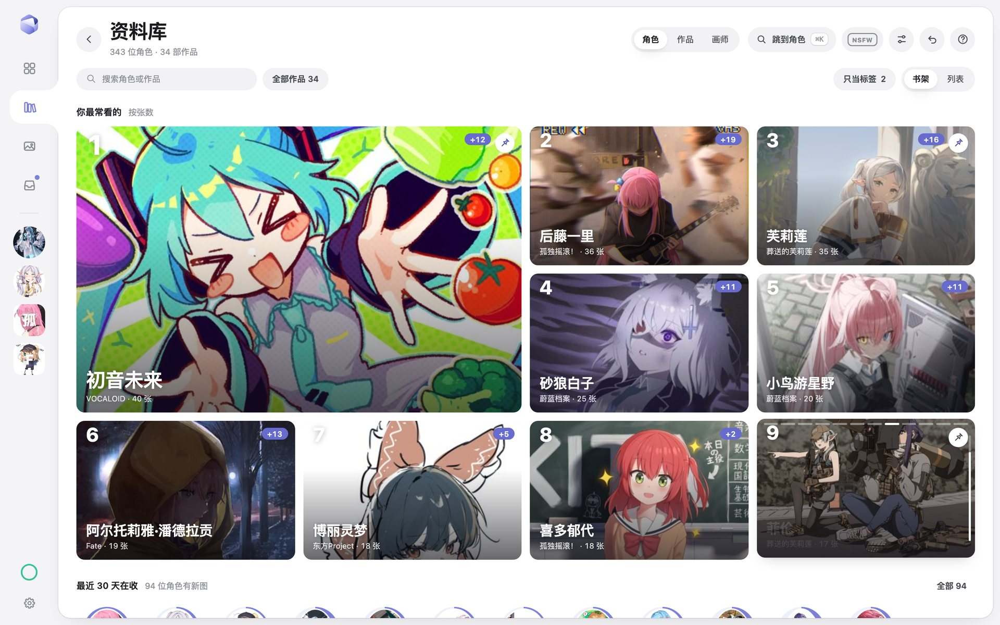
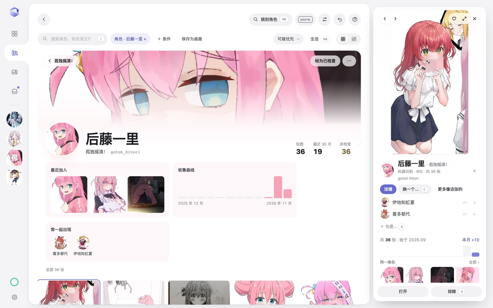
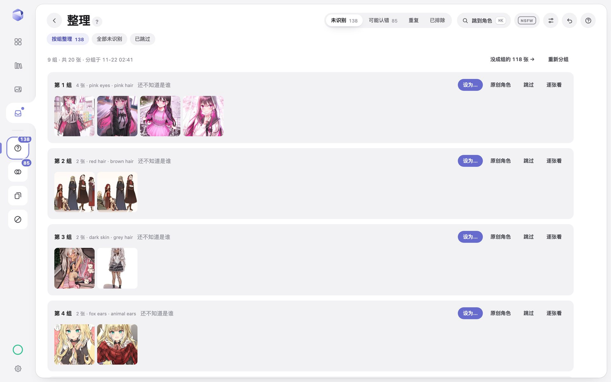
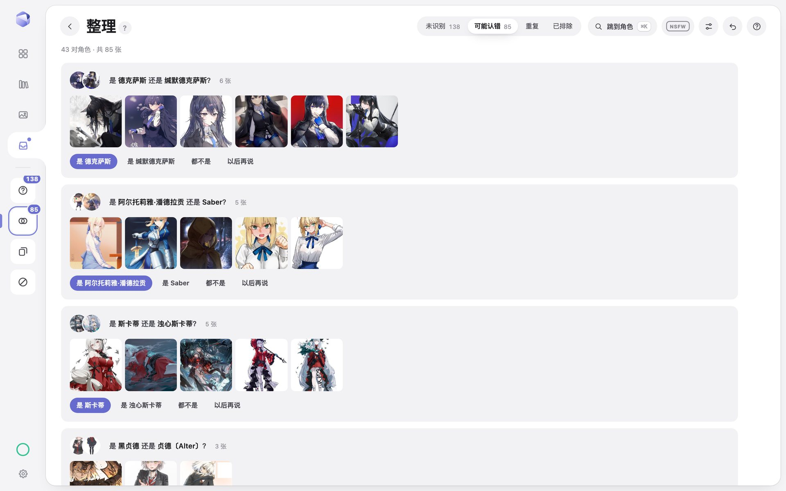
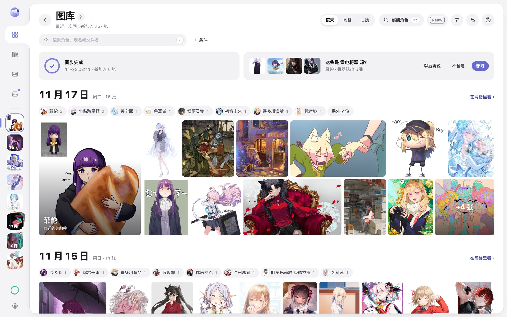
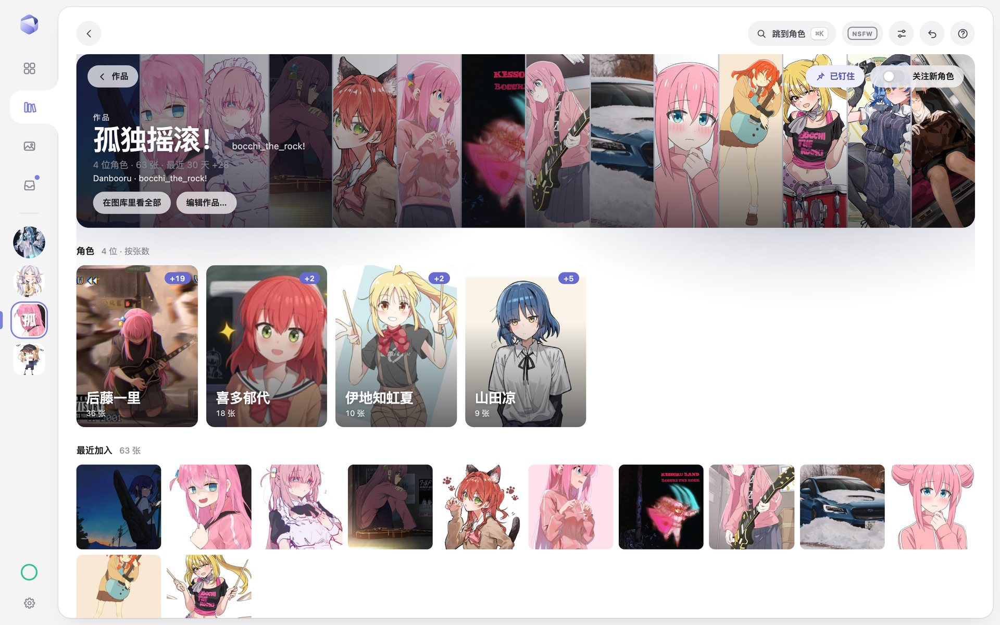
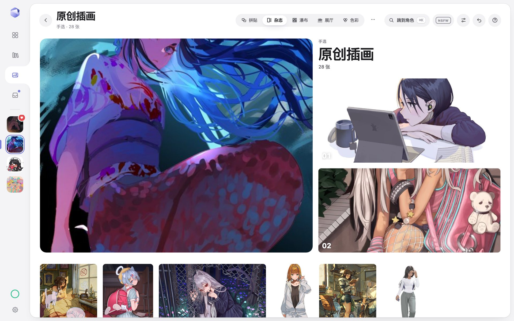
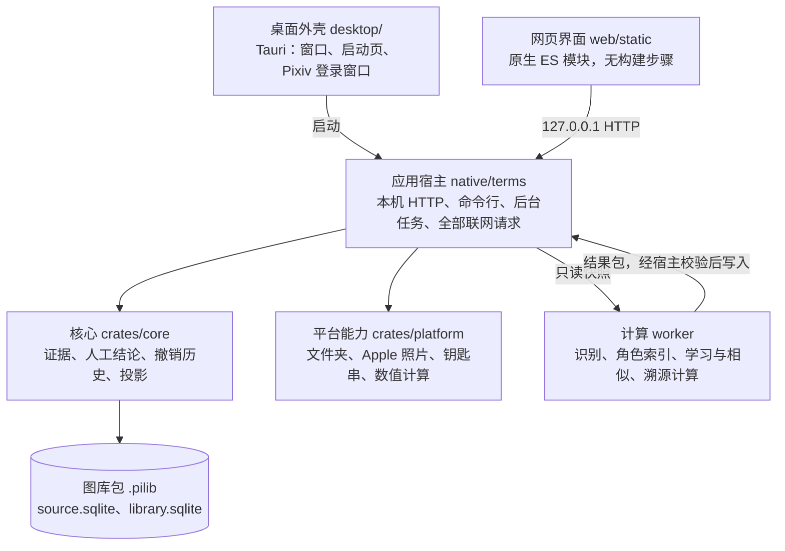

<div align="center">


# Illustash

**ACG 插画的轻量智能相册。**

覆盖 1.5 万+ 角色，本地自动化识别与管理角色、画师和标签

[](https://github.com/shio-vinyl/illustash/releases/latest)
[](LICENSE)
[%20%C2%B7%20Windows%20x64-lightgrey.svg)](#下载)
[](#工作原理)

[**下载**](https://github.com/shio-vinyl/illustash/releases/latest) · [识别与整理](#识别与整理) · [连接 Pixiv 和 X](#连接-pixiv-和-x) · [浏览与管理](#浏览与管理) · [隐私](#隐私) · [工作原理](#工作原理)

[English](README.md) · 简体中文

</div>



<sub>截图来自专门挑选的演示图库。截图里的插画版权归原作者，如需移除请<a href="https://github.com/shio-vinyl/illustash/issues">开 Issue</a>。</sub>

Illustash 读取 macOS「照片」和本地文件夹中保存自 X、Pixiv 的插画，在本机识别角色与画面内容，并按作品、角色和造型生成目录。识别结果可以人工修正，后续识别会参考修正结果。通过连接 Pixiv 和 X，Illustash 能在不上传图片的前提下查找画师与原帖。与 Eagle 等素材管理工具不同，它无需手动建立分类或添加标签。

## 识别与整理

识别与归类由机器完成，人工只需在浏览时确认或修正，修正结果会用于后续识别。

**角色目录**：识别每张图片中的角色，按「作品 → 角色 → 造型」生成目录。作品支持按系列分层，造型涵盖服装、异格和变身等。多人图同时归入其中每个角色的目录。角色支持以中文、日文、英文名称、别名或原始 tag 搜索；资料库尚未收录的作品、角色和原创角色可以手动新建。

**识别范围**：覆盖约 1.5 万个角色。下载模型后即可识别约 7,400 个角色，角色资料包另外覆盖约 8,000 个冷门角色和新角色。资料包周期性更新，更新时只对已有识别结果重新评分，无需重新识别。已关注作品中尚未覆盖的角色，可以从 Danbooru 获取参考图补充。

**运行要求**：安装包小于 40 MB，安装后即可使用，无需 Python、Docker、CUDA 或独立显卡。在 Apple 芯片的 Mac 上使用 Core ML 加速，M2 每小时约可识别一万张；在 Windows 上有显卡时使用 DirectML，仅有 CPU 时同样可以运行。识别结果分批写入图库，识别过程中即可开始浏览。模型的选择依据见[模型选择与取舍](#模型选择与取舍)。

**人机协作**：

- 识别错误时，可以更换角色、移除或合并。确认、否定等标记操作单击即可完成，不弹出对话框，也没有必填项。所有操作均可撤销，重启后仍可撤销。
- 人工确认或否定的结果始终优先，重新识别或更新资料包都不会覆盖。
- 某个角色确认满 5 张后，Illustash 会在本机学习该角色的特征，用于识别该角色的其他服装和画风。
- 置信度较低的结果列入「也可能是」，不计入目录。首页会不定期显示「认一认」卡片，用于为置信度较低或样本较少的角色补充确认样本。
- 未识别的角色和原创角色按外观、发色、瞳色、兽耳等特征自动分组，确认身份后可以整组指定。
- 界面默认不显示待整理数量，无需整理完毕即可使用。







**画面内容**：识别约 8,100 个画面标签，其中约 7,700 个附有中文名称；识别 R18 分级；照片、截图、聊天记录、纯文字图片等非插画内容会被自动排除。也支持添加自定义标签。

**重复与差分**：在本机逐像素比对，识别重复保存、裁剪、加字或去字、打码的版本以及差分，并归为一组。重复图片默认折叠；修改组内任意一张的角色，同组图片同步更新。「判断关系」会标出两张图片的差异区域。

**后续计划**：标记疑似 AI 生成的插画（[#184](https://github.com/shio-vinyl/illustash/issues/184)）。

## 连接 Pixiv 和 X

Illustash 将图库与 Pixiv、X 关联：目前支持查找画师与原帖，后续将接入平台标签与推荐，构建个人口味系统。

**查找画师与原帖**：支持批量查找，全程不上传图片。

- Danbooru 像素哈希：将图片解码后计算像素哈希，用于查找同一张图片，只发送哈希值；不受存图应用修改文件的影响。
- IQDB 图像签名：在本机计算图像签名，用于查找经过缩放或重新压缩的版本，只发送签名。
- 关注列表：将 Pixiv 关注列表（在应用内登录，只读）和 X 数据归档中的关注账号作为候选画师，下载其公开作品的缩略图并在本机比对，匹配后才会确认。缩略图比对完成后即删除，只保留比对用的签名。

找到画师后，可以通过「找 TA 的其他图」查找图库中该画师的其他作品；重复组和相似组中的图片共享已找到的画师；同一时段连续保存的图片列为待确认候选。资料库的「画师」页支持按张数、最近收录时间或名称排序，可以查看单个画师的全部图片，并打开画师主页与原帖。「是 TA」「不是 TA」与其他操作一样可以撤销。

**个人口味系统（计划中）**：Illustash 记录了用户实际保存、排除和否定过的图片，这些信息是平台无法获取的。计划将其与 Pixiv、X 结合（[#609](https://github.com/shio-vinyl/illustash/issues/609)、[#553](https://github.com/shio-vinyl/illustash/issues/553)）：

- 为匹配到原帖的图片添加 Pixiv 标签，并以这些图片为样本，为其他图片推断相同的标签，作为识别的补充；
- 基于收藏训练个人偏好模型，用于图库排序；
- 按个人口味对关注画师的新作、Pixiv 推荐和标签搜索结果重新排序与过滤，并给出推荐理由；
- 使用画风模型为无出处的 Pixiv 图片提供候选画师（[#455](https://github.com/shio-vinyl/illustash/issues/455)）。

上述功能均由用户操作触发，请求量与正常浏览相当，且不上传图片。

## 浏览与管理

**浏览**：资料库提供作品、角色和画师目录。支持收藏；可以从一张或多张图片出发，按画面或角色查找相似图片（「更多像这张的」）。





**筛选**：筛选条支持组合角色、作品、画师、画面标签、自定义标签、出处、年份、日期区间和收藏状态，每个条件均可设为包含或排除；画面标签支持中文、日文和英文搜索。常用筛选可以保存为画廊，显示在侧栏中。R18 内容可以隐藏，也可以单独查看。



**使用**：支持打开原图、在访达或资源管理器中显示、拖放到其他应用，以及按角色或画师分文件夹导出副本。导出不覆盖已有文件，也不修改原图。

**来源与数据**：

- 以只读方式接入 macOS「照片」，仅收录保存自 X、Pixiv 的图片，并按出处分栏；本地文件夹在添加时指定出处。文件夹移动位置后，可以根据相对路径和文件内容恢复原有图片及整理结果。
- 支持多个图库。人工结论自动生成快照，也可以导出为独立文件；升级图库格式前自动备份。
- 任务运行期间关闭窗口，任务会在后台继续执行，完成后发送系统通知。支持应用内检查更新，下载后校验签名再安装。

**后续计划**：桌面端开启局域网入口，手机扫码后即可浏览图库（[#459](https://github.com/shio-vinyl/illustash/issues/459)）。

## 隐私

- 识别、学习和比对均在本机完成。图片及其特征不会上传，不会发送给大模型，也不会用于训练共享模型。
- 不修改原图，以只读方式访问「照片」。
- 联网功能默认关闭，按功能分别授权。设置中列出了每项联网功能发送的内容。
- Pixiv、X、Danbooru 均为可选，使用用户本人的账号以只读、低频方式访问，遇到人机验证或限流时立即停止。Illustash 并非 pixiv 开发或分发的应用，与上述站点均无关联。

## 下载

Illustash 免费开源，最新版本可在 [GitHub Releases](https://github.com/shio-vinyl/illustash/releases/latest) 下载。

| 平台 | 安装包 |
|---|---|
| macOS 14 及以上，Apple 芯片 | `…_aarch64.zip` |
| Windows x64 | `…_x64-setup.exe`，为当前用户安装，无需管理员权限 |

安装包未经 Apple 公证和 Windows 代码签名，首次打开时需要在系统中手动放行，步骤见 [装不上、打不开怎么办](docs/INSTALL.md)。之后可以在应用内检查更新，通过「下载并重启」升级。

识别模型在首次使用时于应用内下载，约 640 MB；Apple 芯片的 Mac 另需约 470 MB 的加速文件。模型也可以离线导入，见 [识别模型](docs/INSTALL.md#识别模型)。界面支持简体中文和英文。暂不提供 Linux 安装包。

### 从源码运行

核心使用 Rust stable 构建；运行时无需 Python，部分构建与检查工具需要 Python 3.12 和 Node 22。

```sh
# 构建核心
cargo build --release --manifest-path native/terms/Cargo.toml

# 首次创建图库：仅登记来源，不扫描图片
./native/terms/target/release/illustash-terms library-create \
    --dest ~/Pictures/Illustash/我的图库.pilib --folder /图片目录

# 启动（默认地址 http://127.0.0.1:8765）
./start-web.command --library ~/Pictures/Illustash/我的图库.pilib
```

从源码运行时需另行准备识别模型。桌面应用（Tauri）、安装包构建、启动参数和图库包结构见 [开发说明](docs/DEVELOPMENT.md)，依赖与计算组件配置见 [安装与平台](docs/BACKEND_TASKS.md#独立安装与可选计算包)。

## 工作原理

本节说明各功能的实现方式与取舍，所列数字均注明口径和测量条件。详细内容见 `docs/` 中的现行参考文档，各小节末尾附有链接。

### 模型选择与取舍

- **模型**：仅使用两个模型。[WD SwinV2 Tagger v3](https://huggingface.co/SmilingWolf/wd-swinv2-tagger-v3)（467 MB）用于识别画面标签、分级和约 2,700 个常见角色；剪枝版 [CCIP](https://huggingface.co/deepghs/ccip)（150 MB）用于提取角色特征，同一角色在不同画师、不同服装下的特征仍较为接近。两个模型均可在没有独立显卡的电脑上运行。更大的模型可以识别更多角色，但硬件要求更高：PixAI Tagger v1.0 的输入为 1008 像素、约 4.9 亿参数，在没有独立显卡时基本无法使用；入库时使用视觉语言模型为每张图片生成描述，在没有独立显卡的电脑上处理整个图库需要数天。这两种方案均未采用。
- **扩充角色**：不更换模型，而是基于已计算的特征扩充。基础角色索引提供约 7,400 个角色的参考特征，与图片的 CCIP 特征进行最近邻匹配；角色资料包是基于已存储 WD 特征的线性分类头。两者都无需重新运行模型，资料包更新后只需对已存储的特征重新评分，因此可以独立于应用定期更新。
- **准确率**：不同界面采用不同标准。浏览界面只显示高置信度结果，低置信度结果列入「也可能是」；单人图只归属一个角色；画师只采用强证据，证据不足时留空。资料包中的大部分分类头只提供候选，不直接修改归属。
- **本机学习**：角色确认满 5 张后，在本机学习原型和判别式认领，结果只保存在当前图库，修改后批量重新学习。不修改模型文件，图片和标注也不用于训练共享模型。
- **加速**：Apple 芯片使用 Core ML，Windows 使用 DirectML，以 CPU 结果为基准；加速失败或输出校验未通过时，该图片改用 CPU 重新计算。在验收样本上，两者仅存在 fp32 舍入差异，判定结果一致。
- **不使用模型的部分**：重复与差分通过逐像素比较判定，结果可复现，并能标出差异区域。查找画师时只发送像素哈希和图像签名，候选结果使用 16×16、24×24 的缩略图在本机核对。

### 整体结构



Illustash 是用 Rust 编写的模块化单体应用，数据存储在 SQLite 中，运行时无需 Python。

- **核心**（`crates/core`）负责业务规则：词条、机器证据、人工结论、撤销历史，以及由此计算出的图片显示结果。核心与平台无关。`crates/iqdb` 在本地计算 IQDB 图像签名，`crates/relation-fft` 提供用于检测裁剪版本的多尺度 FFT 互相关计算。
- **平台能力**（`crates/platform`）将 macOS 与 Windows 的差异隔离在核心之外，包括遍历文件夹、只读访问 Apple 照片、原生文件选择窗口、通过钥匙串或 DPAPI 保存账号凭据，以及基于 Accelerate / OpenBLAS 的数值计算。
- **应用宿主**（`native/terms`）负责图库的创建、打开、升级和备份，提供仅监听 127.0.0.1 的 HTTP 服务，并调度后台任务。所有联网请求均由宿主发出。
- **计算 worker** 是同一个原生程序，负责识别、角色索引、学习、相似扫描和溯源计算。宿主向其提供只读快照或隔离目录，worker 计算完成后返回结果，由宿主校验身份、输入指纹和范围后写入。worker 缺失或崩溃时，浏览、整理和撤销不受影响。
- **网页界面**（`web/static`）直接使用浏览器原生 ES 模块，不经过打包工具。`core/` 下的模块不访问 DOM，可以直接在 Node 中测试。
- **桌面外壳**（`desktop/`）基于 Tauri，仅负责启动宿主、管理窗口和 Pixiv 登录窗口，不包含业务逻辑。

见 [架构现状](docs/ARCHITECTURE_DIRECTION.md)、[开发说明](docs/DEVELOPMENT.md)、[前端模块](docs/WEB_V2.md#前端模块2026-10-18199)。

以下各节默认折叠，点击标题展开。

<details>
<summary><strong>角色识别</strong>：两个模型、三层角色覆盖与本机学习</summary>

每张新图片都在本机经过两个模型处理。WD 输出通用标签、年龄分级和约 2,700 个常见角色的标签；CCIP 输出 768 维角色特征，同一角色无论由谁绘制、穿着何种服装，特征都较为接近。CCIP 特征与角色索引中的参考特征（锚点）进行最近邻匹配，距离在阈值内即记为一条证据。两类来源分别记录，并按经人工结论校准的强度排序：两者一致时最强，其次是单一强证据，最后是弱证据。单人图的归属由该排序决定。基础角色索引由固定版本的 [Character Index](https://huggingface.co/datasets/deepghs/character_index) 计算得出，包含约 7,400 个角色的锚点，不随安装包分发，与识别模型一同下载。

角色资料包覆盖上述两层均未收录的角色，由两部分组成：基于 WD 1024 维特征的线性扩展头，以及低帖数角色的 CCIP 长尾锚点。0.5 版（测试版）共覆盖 7,951 个角色：在 7,859 个扩展头中，296 个一级头可以在规则与人工均未给出归属时补充机器归属，7,563 个二级头只进入「也可能是」，既不补充也不修改归属；另有 92 个长尾锚点。扩展头的开发正例须来自至少两位画师，且阈值须比开发集中最高负例分数高出 2 个 logit，才会保留。在训练和开发均未使用的画师、2026-11-17 之前发布的留出帖子上，整包为已覆盖角色的图片额外引入错误候选的比例为 0.55%（95% 区间 0.42–0.68%）；0.4 版引入的 1,577 个二级头尚未独立验证，计划于 12 月初使用 2026-11-17 之后发布的帖子完成验证。资料包列于一份经过签名的包目录中，独立发布，按图库启用或撤回，撤回时人工结论保持不变。资料库中的「关注新角色」和「检查新角色」按 tag 从 Danbooru 下载公开参考图，在本机计算锚点，补充资料包尚未覆盖的角色，不上传图库中的任何内容。

角色确认满 5 张后，Illustash 使用这些样本在本机学习两项内容。一是**原型**：按密度将确认图片聚为最多 8 簇，分别对应常服、泳装等不同造型；每个原型的认领范围取成员距离的 90 分位，且必须比任何已移出的图片更近。二是**判别式认领**：为每个角色训练一个逻辑回归模型，负例包括已移出的图片和其他角色的确认图片。只有当概率足够高、与某张确认图片足够接近、且比所有已移出图片更近时，才会自动认领。认领范围外围的匹配仅作为线索列入「也可能是」，不参与归属。学习结果只保存在当前图库中，确认、移出或撤销后会批量重新学习。

未识别的角色按 CCIP 特征密度聚类。WD 的外观标签（发色按色系合并，另有瞳色、兽耳、光环、翅膀等）用于拆分混有两种发色的分组，并提示两个分组「可能是同一人」。

推理使用 ONNX Runtime。在 Apple 芯片的 Mac 上，WD 和 CCIP 使用 Core ML，其中 WD 使用固定输入形状、经等价改写的执行变体；在 Windows 上使用 DirectML。CPU 为参考实现：加速会话无法创建或输出校验未通过时，该图片回退到 CPU 重新计算。在验收样本上，加速结果与 CPU 仅存在 fp32 舍入差异，判定结果一致。数据库中记录的模型身份始终取自原始模型文件。worker 读取每张图片后，先核对宿主提供的 SHA-256 再解码，确保结果与实际识别的文件对应。

**速度与规模**（合成样本，仅代表测量所用机器）：在一台 Apple M2（8 核、16 GB）上，WD 和 CCIP 均使用 Core ML，200 张合成图片从扫描到导入完成的三轮中位数为 71.5 秒，约合每小时一万张；其中 WD 单张耗时从 CPU 的 758 ms 降至 178 ms。在一台配备独立显卡的 Windows 机器上使用 DirectML，两个模型的单张推理耗时从约 860 ms 降至约 180 ms；仅有集成显卡的 Windows 机器尚未测试。在 50 万张的合成图库上（Windows，i7-11800H），打开图库约 0.13 秒，读取一页 100 张及总数约 0.19 秒，无变化时同步一次约 56 秒。见 [词条核心性能](docs/TERMS_PERFORMANCE.md) 第 6、7 节。

见 [角色与皮肤](docs/TERMS_CHARACTERS.md)、[识别结果包](docs/RESULT_PACKAGES.md)、[识别的执行后端](docs/BACKEND_TASKS.md#识别的执行后端)、[角色资料包](docs/INSTALL.md#角色资料包)、[新角色流程](docs/WEB_V2.md#新角色流程相似分组与边标边学2026-09-24)。

</details>

<details>
<summary><strong>人工结论优先</strong>：机器证据与人工结论分开存储，所有操作共用一套撤销机制</summary>

角色、作品、画师、分级和自定义标签在核心中统一为**词条**。为图片添加词条的操作称为「贴」，机器与人工遵循同一套规则。机器证据只增不删，不同来源之间互不覆盖。裁决只来自人工，「不是」永久有效。图片上显示的状态（人工确认、机器认定、也可能是或已否定）每次都由证据、裁决和词条类型策略重新计算得出。

两类数据分开存储。worker 只能以证据包或识别结果包的形式提交机器证据，包中一旦出现人工来源即整包拒绝，因此计算代码在结构上无法写入人工结论。重新识别或更新角色索引只替换同一范围内的旧机器证据，人工结论保持不变。已移出的角色不会被后续证据重新添加。

每次人工操作都在一个数据库写事务内完成：解析选集、校验、写入并记录一步历史；任一环节失败即整步回滚，不会出现部分写入。撤销只有一套机制：按全库最近一步撤销，无论该步修改的是角色、标签、画师还是收录状态，重启后仍可撤销。核心维护的派生表设有写保护，绕过核心的写入会直接报错，不会静默生效。

见 [词条](docs/TERMS.md#2-核心抽象词条)、[证据包](docs/EVIDENCE_PACKAGES.md)、[归属规则与 API](docs/WEB_V2.md#归属规则)。

</details>

<details>
<summary><strong>找回出处</strong>：多路线索提供候选，统一在本地验证</summary>

溯源采用「种子加验证」结构：多路线索分别提供候选画师或直接命中的原帖，再统一进行本地验证。

- **Danbooru 像素哈希**：将图片解码为 sRGB 加 alpha 的原始像素后计算 MD5，算法与 Danbooru 一致，不受存图应用改写文件元数据的影响。对外只发送哈希值；命中即表示像素完全相同，不会误判。
- **IQDB 签名**：`crates/iqdb` 在本地计算 IQDB 感知签名，只发送签名文本，可以找到经过缩放或重新压缩的同一张图片。查询队列按各来源和分级的历史命中率排序，优先查询最可能命中的图片。
- **关注列表**：Pixiv 使用在应用内登录的账号，以只读方式获取关注列表；X 通过导入官方数据归档，只读取 `following.js` 中的数字账号 ID，不联网。关注的账号作为候选画师。
- **本地验证**：下载候选画师在 Danbooru 和 Pixiv 上最新公开作品的缩略图，在本机先以 16×16 签名比对，再以 24×24 彩色缩略图复核。比对通过才计为找到；缩略图使用后即删除，只保留这两种签名。
- **分组继承**：重复组或相似组中已有图片找到画师时，整组共享该画师；同一时段连续保存的图片只作为待确认候选。

不上传原图是底线，也带来取舍：由于只发送哈希和签名，能够找回的主要是已被转载到 Danbooru 的作品。在作者本人的图库（约 5 万张）上，仅像素哈希一路即可为约两成的 X 图片找回画师，Pixiv 图片约为 6%。识别出画师后，「找 TA 的其他图」通过本地验证进一步扩展。人工的「是 / 不是 TA」属于核心中的裁决，与其他操作一样可以撤销。溯源只写入独立的 `provenance.sqlite`，不涉及人工结论。

见 [溯源](docs/PROVENANCE.md)，其中第 8 节为现行流程。

</details>

<details>
<summary><strong>重复与差分</strong>：签名、候选图对与逐对像素比较</summary>

字节完全相同的副本按文件哈希归组。进一步的相似扫描在本机分三步进行：

1. **签名**：每张图片解码一次，记录画布比例和 16×16 灰度缩略图。
2. **候选图对**：在画布比例相同且缩略图高度相关的图片中，每张最多选取 12 张最相似的图片；另以 CCIP 距离极近的图对覆盖裁剪版本。已比较过的图对不再重复比较。
3. **关系判断**：逐对进行像素比较，不使用模型。先缩放到同一尺寸，容许 1 像素错位，再由粗到细对齐，然后根据变化区域的大小、位置和统计特征，归为重复、调色、边缘加字、色块或马赛克打码、差分、细微差分（改动面积小于 2%）、构图相似或不同图片。比例不同时，使用多尺度 FFT 归一化互相关在一张图中定位另一张，以判断是否为裁剪版本。

所有结论均写入数据表，包括「不同的图」。随后使用并查集，将字节相同的副本和设置中选择折叠的关系合并成组，以组内分辨率最高的图片作为代表。组内角色不一致时暂不折叠，待人工对齐。对组内任意一张图片的修改，会在同一事务中应用到整组。

见 [图片关系判断](docs/WEB_V2.md#图片关系判断2026-09-24) 与 [全库找相似](docs/WEB_V2.md#全库找相似2026-09-24)。

</details>

<details>
<summary><strong>图库包</strong>：<code>.pilib</code> 文件夹的内容与可删除项</summary>

每个图库是一个 `.pilib` 文件夹：

| 内容 | 说明 | 能否删除 |
|---|---|---|
| `library.json` | 名称、永久 ID、来源列表、包格式版本 | 不能 |
| `library.sqlite` | 人工结论、机器证据、撤销历史与派生表 | **不能**，它不是缓存；损坏时需换回备份（见下文） |
| `source.sqlite` | 来源快照与识别结果（标签、特征） | 不建议删除。识别可以重做，但文件夹图片的 ID 在首次扫描时生成，人工结论依赖这些 ID 关联；损坏时使用应用内的抢救功能，可保留这些 ID |
| `provenance.sqlite` | 溯源的查询缓存与机器结果 | 不包含在导出包中 |
| `thumbnails/` | 缩略图缓存 | 可以随时删除，会自动重建 |
| `library-backups/` | 升级前必需的 SQLite 回退副本 | 回退时需要 |
| `backups/` | 手动 SQLite 备份与损坏源库留证 | 自行决定 |
| `backups/human-conclusions/` | 当前人工结论的自动快照 | 保留最近 30 份成功快照 |

`library.json` 中的 `format` 为包格式版本，两个数据库另有各自的 schema 版本。遇到比当前程序更新的格式时直接拒绝打开，不做猜测。打开旧图库时不会自动升级：需经用户确认，升级前使用 SQLite 备份接口将 `library.sqlite` 备份到 `library-backups/`，再在单个事务中完成迁移，未完成则保持原状。上次未正常关闭的图库，下次打开前会先对两个数据库进行完整性检查。导出的 `.pilib.zip` 只包含配置、两个数据库和特征，并清除 API key 等密钥，可用于分享。

`library.sqlite` 损坏时，Illustash 停止写入并提示如何换回备份，具体步骤与可用的备份见 [图库](docs/LIBRARIES.md#3-资产-id-和链接)。人工结论另有自动快照：成功打开图库后生成一份，此后的修改合并 60 秒后写入，两份自动快照至少间隔 1 小时，内容无变化时不生成，保留最近 30 份（不等同于 30 天）。快照与图库存放在同一位置；也可以手动导出为独立文件，在图库丢失后为重建的图库恢复可对应的人工结论。见 [人工结论快照](docs/LIBRARIES.md#人工结论快照)。

见 [图库](docs/LIBRARIES.md#1-图库包里有什么) 与 [升级边界](docs/ARCHITECTURE_DIRECTION.md#已有核心库的显式升级边界)。

</details>

<details>
<summary><strong>隐私保障</strong>：计算离线、按功能授权、本机服务防护</summary>

- **计算离线**：识别、索引、学习和相似扫描都在宿主准备的快照或隔离目录中进行。溯源所需的公开缩略图由宿主按站点白名单、授权、限速和流量上限代为获取，再交给 worker。
- **按功能授权**：名称查询按图库授权一次，可以随时撤销，只发送 tag 名称、作品名称等文字（为图片设置角色时，Danbooru 候选会按 tag 获取一张全年龄预览图）。「找回画师」和「检查新角色」每次运行前都需确认；按需查找时，点击按钮即视为授权本次操作。保存账号或修改启动偏好都不视为授权联网。遇到 403、429、人机验证或维护页面时，立即停止访问该站点，不尝试绕过。「设置 › 网络与隐私」以表格列出全部联网功能、对应服务及发送内容。
- **模型与更新**：识别模型仅在点击下载时联网获取，也可以离线导入。检查更新默认关闭，开启后定期查询 GitHub 的版本列表，不发送图库信息；角色资料包目录仅在首次准备和检查更新时一并读取。有新版本时，只有点击「下载并重启」才会下载，并在校验签名后安装。
- **大模型只处理文字**：图片及其特征从不发送给任何大模型。唯一与大模型相关的是可选的「名称翻译」：Bangumi 缺少中文名时，使用用户自行配置的兼容 OpenAI 接口的模型翻译，只发送 tag、日文名和作品名；未配置时不启用。
- **关闭 ONNX Runtime 遥测**：官方构建默认开启遥测。宿主启动每个 worker 时设置 `ORT_DISABLE_TELEMETRY=1`，worker 启动时再次设置；加载运行库前若该值不正确，则拒绝加载。Windows 上另在会话中关闭遥测事件，打包时还会检查 DLL 是否接入微软的遥测通道。
- **Windows 上的 DirectML**：用于 GPU 加速识别的微软 DirectML 组件登记在系统遥测通道中，根据其许可，可能按系统的「诊断数据」设置向微软发送使用信息。如不希望使用，可以在「设置 › 数据 › 识别模型」中关闭「使用 GPU 加速识别」，改为仅使用 CPU 且不加载该组件，见 [装不上、打不开怎么办](docs/INSTALL.md#windows)。
- **本机服务防护**：127.0.0.1 对本机所有进程开放，因此每个请求都须携带会话 cookie。cookie 只能通过启动时生成的一次性码换取，写请求还需额外的 CSRF 令牌。账号凭据保存在 macOS 钥匙串或 Windows DPAPI 中，不以明文存储。

见 [产品底线](docs/BACKLOG.md#产品底线与已定的约束新会话先读)、[第三方组件](docs/THIRD_PARTY.md#打包时加入的运行库)、[启动信号与会话 cookie](docs/ARCHITECTURE_DIRECTION.md#启动信号与会话-cookie)。

</details>

## 反馈与贡献

功能取舍优先考虑作者本人的使用需求。

- **报告问题**：请通过 Issue 使用 [「报告问题」模板](.github/ISSUE_TEMPLATE/bug_report.md) 提交，并附上操作系统、「设置 › 关于 › 复制诊断信息」的内容和复现步骤（请勿附上真实图片、图片文件名、本机路径或账号信息）；安装或启动失败时，请先查阅 [装不上、打不开怎么办](docs/INSTALL.md)。
- **功能建议**：可以使用 [「功能建议」模板](.github/ISSUE_TEMPLATE/feature_request.md) 提交，但不保证采纳或实现。
- **代码贡献**：目前暂不接受代码贡献（Pull Request）。

## 许可

Illustash 的源代码以 [GPL-3.0-or-later](LICENSE) 许可证发布，并依据 GPLv3 第 7 条附加一项许可，允许本程序与 Microsoft DirectML 等 GPU 推理运行库一同分发和运行，全文见 [附加许可](docs/THIRD_PARTY.md#附加许可gplv3-第-7-条)。

第三方组件、模型及数据遵循各自的许可协议，详情见 [第三方组件与许可](docs/THIRD_PARTY.md)。随附或需要另行准备的识别模型、角色索引与其他数据，不受本项目代码许可证的统一授权。识别所用的 CCIP 模型（仓库与安装包均不包含，首次使用时从上游下载或另行准备）依据 BigScience Open RAIL-M 许可提供，其使用和再分发受该许可第 5 条及附件 A 的使用限制约束。

Illustash 的名称与图标不随代码一同授权。基于本项目开发的修改版本，请使用其他名称和图标。

## 致谢

角色与画面识别使用 [SmilingWolf 的 WD Tagger](https://huggingface.co/SmilingWolf/wd-swinv2-tagger-v3)、[DeepGHS 的 CCIP](https://huggingface.co/deepghs/ccip) 与 [Character Index](https://huggingface.co/datasets/deepghs/character_index)；标签和角色资料来自 [Danbooru](https://danbooru.donmai.us)，角色中文名称来自 [Bangumi](https://bgm.tv)；画面标签的中文名称取自 [danbooru-tags-data-zh](https://github.com/amenorira/danbooru-tags-data-zh)，日文名称取自 [CharaDB](https://github.com/taki-ttt/charadb)。

---

<sub>关键词：ACG 插画 · 二次元插画 · 插画收藏 · 二次元相册 · 本地图库 · 图片管理 · 角色识别 · 以图搜源 · 找画师 · 重复图片 · Pixiv · X（Twitter） · Danbooru · IQDB · 离线 · 隐私 · Tauri · Rust · SQLite · ONNX Runtime · macOS · Windows · anime illustration manager · image library · character recognition</sub>
